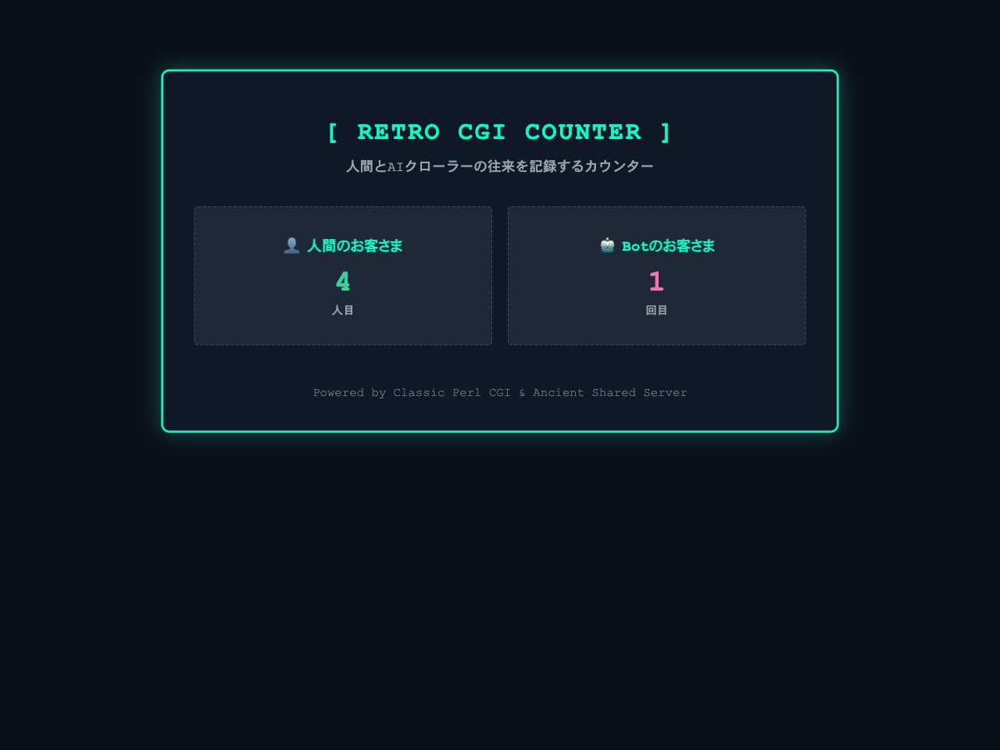

# レトロアクセスカウンタ


古き良きCGIサーバー（Perl）で稼働する、人間とAIクローラーの往来を記録するアクセスカウンタです。AI Botが行き交う現代、あなたのウェブサイトのアクセントにいかがでしょうか。

## 特徴 (Features)

- レトロなUI: 昔懐かしのアクセスカウンタ文化を、現代的なダークテーマで再解釈。
- Botと人間の振り分け:
  - 人間のお客さま: HTMLテンプレートを表示し、両方のカウンターを表示。
  - Botのお客さま（AIクローラー等）: HTMLの描画コストをカットし、軽量なテキストメッセージと統計情報を返却。
- サーバーに優しい超軽量設計: 外部DB不要。テキストファイルと数行のPerlスクリプトだけで動作するため、CGIしか使えない古いレンタルサーバーでも軽快に動きます。

## 必要要件 (Requirements)

- Perl が実行できるWebサーバー（古き良きレンタルサーバー、またはローカルのCGI環境）
- 対応文字コード: **UTF-8（BOMなし）** （古き良き仕様のため非対応の場合、文字化けの可能性があります）

## ファイル構成 (File Structure)

```text
cgi-bin/
 ├── index.cgi         # Perlスクリプト本体（ロジックとBot判定）
 ├── index.html        # デザインテンプレート（人間向け）
 ├── .htaccess         # テンプレートの直接アクセスブロック用
 ├── counter_human.txt # 人間用カウンター（初回アクセス時に自動生成）
 └── counter_bot.txt   # Bot用カウンター（初回アクセス時に自動生成）
```

## 導入・設置方法 (Installation)

1. リポジトリ内のファイルをすべて、サーバーの公開ディレクトリ（またはCGI実行可能フォルダ）にアップロードします。
2. ファイルの権限（パーミッション）を設定します：
   - index.cgi: 755 （実行権限）
   - index.html および .htaccess: 通常の読み込み権限
   - カウンター用テキストファイル（counter\_\*.txt）は、初回アクセス時に自動生成されますが、もし書き込みエラーが出る場合はあらかじめ空ファイルを作成し、書き込み権限（666 など）を付与してください。
3. ブラウザから index.cgi にアクセスして動作を確認します。

## カスタマイズ＆サイトへの埋め込みガイド (Customization)

「このレトロカウンターを自分のサイトの一部として組み込みたい」「デザインをもっとオリジナルにアレンジしたい」という場合の改造ポイントです。

1. デザイン（見た目）を変える (index.html)
   表示のデザインや色彩はすべて `index.html` 側に集約されています。CSSを変更することで、お好みのテイストに自由に変更できます。
   - アクセントカラーを変える: `<style>` 内の `#00ffcc`（ネオンシアン）や `#34d399`（グリーン）のカラーコードを書き換えます。
   - フォントを変える: `font-family` を `monospace` からレトロゲーム風のフォントや明朝体にすると雰囲気がガラリと変わります。

2. カウンター部分だけを自分のサイトに埋め込む
   「サイト全体をこのCGIにするのではなく、既存のホームページの片隅にカウンターだけを貼りたい」という場合は、`index.html` の中身を削ってカウンターのカード部分（`<div class="counter-box">...</div>`）だけを抽出し、ご自身のHTMLファイル（例: `index.shtml` やSSI対応ページ）にインクルードするか、iframe等で読み込ませることで埋め込み可能です。

3. Bot判定キーワードを追加・調整する (`index.cgi`)
   新しいAIクローラーや特定のスクレイパーを個別に対象外にしたい場合は、`index.cgi` 内の `@bot_keywords配列` にキーワード（小文字）を追加してください。

```Perl
my @bot_keywords = (
'gptbot', 'claudebot', 'anthropic', 'bytespider', 'ccbot',
'googlebot', 'bingbot', 'yandexbot', 'duckduckbot', 'baiduspider',
'facebookexternalhit', 'twitterbot', 'applebot', 'ia_archiver',
'ここに新しいキーワードを追加'
);
```

## ローカルでの動作確認方法 (Local Testing)

Pythonがインストールされている環境であれば、ローカルで簡単に動作確認ができます。

1. ファイル一式をまとめたフォルダでターミナルを開きます。
2. 以下のコマンドでCGIサーバーを起動します：

```Bash
python3 -m http.server --cgi 8080
```

3. 人間として確認する:
   ブラウザで http://localhost:8080/index.cgi にアクセスします。

4. Botとして確認する:
   別のターミナルを開き、curl でUser-Agentを偽装してアクセスしてみます：

```Bash
curl -A "GPTBot/1.0" http://localhost:8080/index.cgi
```
